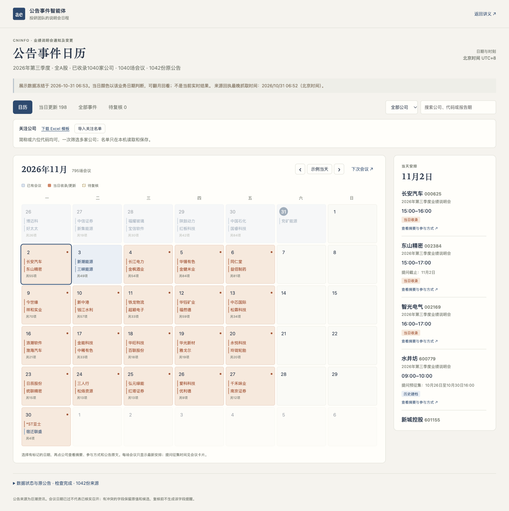
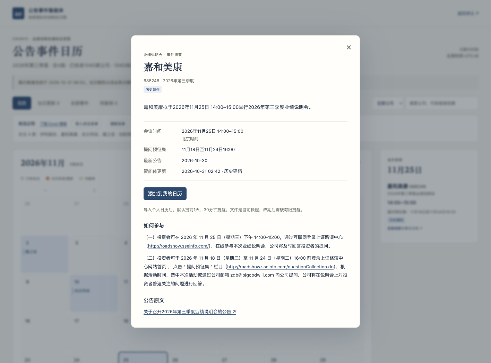
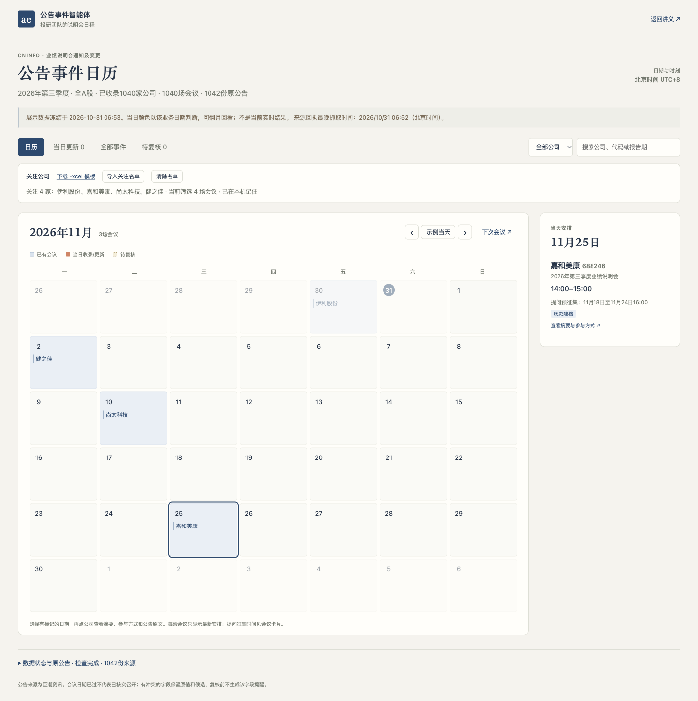

# 从零搭建公告事件智能体

从巨潮公告出发，做出能按日历安排参会、查看摘要、设置提醒并持续更新的公告事件产品。

一家金融企业的投研团队需要安排业绩说明会、提前准备问题。通知散在公告里，改期又会另发一份。研究员真正需要的是知道哪天有哪家公司、何时准备问题、怎样参加，并在事前收到提醒。我们希望让智能体自己取回公告、保留依据、按时更新，再把结果放进一个每天能用的事件日历。

这一讲请你代入业务需求方，用自己的编程Agent从空目录开始搭建。先聊清需求，做出第一小步，检查它留下的文件和网页，再带着具体问题继续修改。最后交付的是一个公告事件智能体，以及可以展示和检查它工作的产品页面。

## 先看成品：公告事件日历

打开[公告事件智能体展示产品](example/index.html)，先用日历完成一次参会安排：翻到11月，选日期、看公司、打开事件摘要，再查看完整参与方式和公告原文。也可以搜索伊利或嘉和美康，与[两家公司起步样例](example/small-sample.html)对照。

<figure class="product-preview"><figcaption>全A股两个月的三季度会议日历。日期中有当日收录或更新时突出显示，当前会议按最新安排显示，过往日期仍可回看；选日期后查看该日公司。</figcaption></figure>

<h3>先看哪天有安排</h3>
有会议的日期与空白日期颜色不同。今天收录或发生更新的安排突出显示，历史会议可回看；改期后旧日期的卡片移除。可搜索公司，也可导入关注名单。

<h3>再看公司和摘要</h3>
点击日期看公司，再点公司看整场起止时间、提问预征集区间或准确截止、完整参与方式与原公告。改期与冲突直接出现在这场会议的详情中。

<h3>把安排加入提醒</h3>
在这场事件的详情中下载会议及已确认截止的日历文件，导入自己的日历。文件含提前1天、30分钟的提醒；不确定字段不生成提醒。

主展示使用本轮全A股扩围中核验通过的三季度会议，会议日期限定2026年10—11月；两家公司起步样例另行保留。只有半年报、年度或其他报告期的说明会不进入本次产品；同一场合并包含三季度时标明“合并召开”，仍只计一场。往期事项被另一份公告提及时也不另建事件。展示版冻结于明确的一轮实际运行，具体数量和来源时点见页面；图例中的“当日”指该轮日期，自己的实时产品按北京时间判断“今天”。首次回看的旧公告标为历史建档，当天披露并收录、后续新发现、安排变更和提取校正分别说明。不能为展示两种颜色虚构旧收录日期。

<figure class="product-preview"><figcaption>从全市场产品打开嘉和美康详情。11月25日14:00—15:00举行会议；提问预征集为11月18日至11月24日16:00。参与方式与原公告在同一处。</figcaption></figure>

“如何参与”直接显示原公告的完整步骤，伊利电话会议的三条路径与上证路演中心的音频、网络互动方式全部保留，原文中的网址可以点击，不另加通用入口按钮或展开控件。

也可查看[伊利参与方式实拍](assets/participation-preview.png)、[手机宽度的日历](assets/mobile-calendar-preview.png)和[手机宽度的事件详情](assets/mobile-event-detail-preview.png)。

“全部事件”按会议日期从新到旧，同一天再按开始时刻倒序。“当日更新”沿用现有标签查看，不另外增加表格。日历旁只列选中日期的公司；进入具体事件后再添加提醒。“公告原文”只列原通知与变更公告的链接，每份文件出现一次。嘉和11月24日16:00是提问截止，伊利相应事项是预报名截止，不能合写为一个含糊标签。

日历与“当天安排”只列会议。会议起止时间放在主行，下一行显示公告明确的提问预征集区间。只注明截止时就只写截止；报名按报名命名，未写的起点不补。更正后更新同一张会议卡，旧日期不再出现，原通知与变更可在详情中回看。同一天先列当日收录或更新，再按会议开始时间排列。

固定跟踪多家公司时，先下载[关注公司 Excel 模板](watchlist-example.xlsx)，每行填公司简称或六位股票代码。导入后，日历、当日更新、全部事件和复核视图都按这份名单筛选，刷新会恢复本机名单。清除后回到全部公司。名称歧义、代码不匹配或文件有问题时，整份导入停止，原名单保留。名单中本期无会议的公司继续保留，不能当作上传失败。

成品由后台Agent和前台日历组成。后台定时查询、下载、提取、核验和更新；前台供研究员安排参会。运行编号、来源覆盖等检查信息放在下方辅助入口。

日历文件是导入时的快照，不是自动订阅。导入后核对两条提醒，并确认日历应用允许通知。公告改期或取消后，需要检查并更新已导入的旧提醒。后台每天取数与个人日历提醒是两个环节，分别验收。

## 动手之前，先看整体步骤

下面六项是智能体运行时做的事。后面的第0至9步，是你和编程Agent把它搭出来的顺序。

<ol class="flow"><li>系统任务<strong>按计划启动</strong>
到约定时间自动执行，留下本轮编号与开始时间。
</li><li>程序<strong>查询与保存公告</strong>
核对公司身份，查全约定窗口，保存原始响应和PDF。
</li><li>模型<strong>识别并提取事件</strong>
判断是否属于说明会通知，提取时间、报告期和原文。
</li><li>程序＋业务方<strong>检查字段与证据</strong>
程序查格式、页码和引文，业务方抽查原PDF及矛盾。
</li><li>程序<strong>维护同一场会议</strong>
去重、关联变更，保留历史及待复核字段。
</li><li>产品页面<strong>更新日历与提醒</strong>
标出会议日，附提问征集时间，提供原文和可导入的提醒。
</li></ol>

<h3>你使用的编程Agent</h3>
任选能读写项目并运行程序的工具。它负责搭建和修改，下文的短需求与反馈都发给它。

<h3>你做出的公告事件Agent</h3>
是本机独立运行的程序，负责查询、更新和定时执行。日常运行不需要编程Agent一直留在对话中。更新后的网页和日历提醒文件使用同一批已核验字段。

<h3>程序调用的提取模型</h3>
通过自己的硅基流动账号使用。先试4B，再根据同一标准比较9B、27B，和编码模型分别配置。

本次实测选择固定步骤配合模型提取。模型负责分类和读原文，程序掌握查询覆盖、状态提交与停止条件。是否再加规划器，可以在完成主线后用实测比较。

## 开始前：准备项目、材料与账号

### 准备一个空项目

新建英文文件夹，例如`announcement-agent`，用你选好的编程Agent打开。下载[起步材料包](lesson3-starter.zip)后把两份小文件放进去，也可以直接从空目录开始。起步包只有短业务说明、公司身份和来源网址，原公告由你的Agent实际查询和下载。

### 确认编程Agent能工作

确认它能在这个文件夹里创建文件、运行程序和读取网页。若只给方案不实际操作，检查当前是否处于允许编辑和执行的模式。Python、PDF读取工具和其他最小依赖可以由它按本机环境检查、安装并说明。

### 准备自己的硅基流动账号

准备程序可用的API Key，在[硅基流动控制台](https://cloud.siliconflow.cn/)检查自己的模型和可用额度。让编程Agent指导你使用用户级配置或隐藏输入，不把密钥放进代码、网页、共享聊天或材料包。编码模型能聊天，不等于生成的程序已经获得同一项授权。

### 确认能访问巨潮

打开[巨潮资讯](https://www.cninfo.com.cn/)，试着查找伊利股份600887、嘉和美康688246，并打开一份原始PDF。课前只确认来源可访问，不把预先下载好的公告当成这次Agent已经会取数。

### 分清材料的用途

| 材料 | 里面是什么 | 什么时候使用 |
| --- | --- | --- |
| [起步包](lesson3-starter.zip) | 短需求、两家公司身份、巨潮入口 | 现在使用，从自己的需求和代码开始 |
| [本期三季度验证包](lesson3-q3-validation.zip) | 18份PDF、40页，分2份起步和16份扩围，含候选标准与评分工具 | 每批第一次提取后评分，不提前给模型答案 |
| [扩围后追加检查](lesson3-expansion-checks.zip) | 7份PDF、15页，覆盖集体业绩说明会、特殊编号、图片封面等实际问题 | 扩围后做回归检查，不并入原18份的首次成绩 |
| [历史回归包](lesson3-validation.zip) | 原12份、35页，含半年报及范围外类型 | 仅隔离测试组件与排除逻辑，不作为当前产品输入 |
| 教师参考实现 | 可运行Agent、测试与使用说明 | 教师核对或明确说明原因后的恢复，入口在讲义末尾 |

### 这次跟做怎样推进

先用一两家公司跑通并核验，再扩大到全A股、会议日期在2026年10—11月的三季度说明会，检查通过后再接定时任务。先看每步目标，再发送适合自己进度的短需求。等Agent实际做完，打开文件或网页，对照“应该看到”和“确认后再继续”。如果有问题，指出具体记录、原文或运行结果，再用折叠的反馈例子继续。

首节按约90分钟安排，优先完成真实取数和可靠的手动产品。去重、变更、两个月扩围核验与真实定时触发可以续讲，全部验收后才算完成这一主题。当前已做过独立Agent从零搭建模拟，还没有真人教师在90分钟内完成全程的试讲证据。

## 第0步：从需求出发，确定第一小步

先让Agent理解业务用途和完成标准，再开始写程序。

### 现在怎么做

1. 在自己的新项目中描述投研团队的日常工作。
2. 回答Agent对公司、范围、频率、时区和结果入口的追问。
3. 请它先做最小一部分，并检查本机运行条件。

### 发给你的Agent

> 我们投研团队要跟踪伊利和嘉和美康2026年三季度的业绩说明会，安排参会和准备问题。想做一个会定时查巨潮、更新事件日历的助手，让我们看公司摘要、原公告并安排提醒。先和我聊清楚需求。

AI可能询问覆盖公司、哪些公告算目标、回看多久、在哪台电脑运行、日历怎样展示、提醒怎样送达。试点可以这样回答：

> 先做伊利股份600887、嘉和美康688246，只看业绩说明会召开通知及变更。首次回看90天，结果放在本机网页。按北京时间每天08:30检查。

巨潮周末也披露公告，这里选择每天检查。业务时间也要和电脑本地时间区分，这里的08:30北京时间对应日本时间09:30。提醒先在具体事件详情中下载日历文件，默认提前1天、30分钟。首次回看的旧记录和后续新更新要区分；邮件、飞书或自动订阅可在主线后另做。

### 应该看到

- 一份简短需求记录，写清服务对象、公司身份、公告范围、频率、时区和产品入口。
- 最小搭建顺序，以及当前环境缺什么、怎样补齐。

### 确认后再继续

- 你能复述这个Agent每天做什么、去哪里看结果。
- Agent准备先实际做出一小步，未把设计文档当成成品。

### 本步产物

自己的需求记录、环境检查结果和下一小步。文件名可由你的Agent决定。

### 卡住时

> 先缩小范围。只把两家公司查对，列出公告并让我打开原文。等来源通过，再加提取、日历和定时功能。

## 第1步：让Agent从巨潮自己取回公告

让第一条结果从真实查询开始，并能回到原文。

### 现在怎么做

1. 让Agent实际查询两家公司最近90天的候选公告。
2. 核对公司代码、标题、发布时间和链接。
3. 打开至少一份下载的PDF，再看分页与覆盖记录。

### 发给你的Agent

> 请现在实际查巨潮，列出这两家公司最近90天的候选公告。保留查询条件、每页结果和原PDF，让我能核对公司与来源。查询失败要明说。

程序可以使用网站实际提供的查询请求。让Agent说明怎样确认结果已取全，例如是否读到最后一页、总量是否一致、日期条件是否生效。

### 应该看到

- 两家公司各有查询成功或失败记录，原始响应和PDF已经保存。
- 公告列表可以打开原文，代码、名称和标题相符。

### 确认后再继续

- 没有用搜索摘要替代公告正文。
- 空结果、请求失败和分页未完成有不同状态。
- 能说明查询覆盖了哪些公司、日期和关键词。

参考实现使用“业绩说明会”关键词，完整性只覆盖约定查询条件。若要覆盖不含该词的变更标题，需要另做召回检查。2026年10月30日的首次窗口取得伊利2份、嘉和3份关键词候选PDF；按三季度筛后各1份。候选公告数不等于本期会议数。

### 本步产物

查询条件与响应、候选公告目录、原PDF及文件指纹。

### 卡住时

> 先给我看这次请求和实际返回，区分没有符合条件的公告和没有查成功。先查清原因，保留已有记录。

## 第2步：先做一个能操作的日历产品

从第一批真实来源做出日历骨架，尽早检查产品的使用顺序。

### 现在怎么做

1. 让Agent搭一个可以翻月、选择日期的本机日历。
2. 把刚取得的真实公告先放在待提取区域，确认公司和原文能打开。
3. 确认“日期→公司→摘要→原文”的操作顺序，尚未提取日期的公告不能填入某一天。

### 发给你的Agent

> 先做一个能翻月、点日期看公司的事件日历，再点公司看摘要和原公告。刚取回的公告还没提取日期，就放在待提取区，不要编日期。做好后打开让我试。

### 应该看到

- 浏览器已有自己的日历，翻月和日期选择可用。
- 真实公告的公司、标题和原文入口可查看，未完成字段有明确空状态。

### 确认后再继续

- 页面显示的公告与第1步保存的来源一致。
- 没有虚假的运行进度、编造日期或不能工作的“开始运行”按钮。
- 日历日期、当天公司列表和事件摘要有明确位置；电脑和手机均能操作。
- 缩矮或缩窄窗口后，日期格的文字仍可读。长名称可以省略，点日期后要能查看公司全称。

### 本步产物

可操作的日历骨架、真实来源列表和本机启动说明，后面继续扩展同一产品。

### 卡住时

> 现在只有结果表，还不像日历产品。请让我能翻月、选日期、点公司开详情；未知日期仍留待提取，原文入口先接通。

## 第3步：用4B提取，再逐条对照原文

先检查一条提取能否站得住，再扩大到多份公告。

### 现在怎么做

1. 让Agent读一份完整PDF，按物理页保存文本。
2. 使用自己账号可用的4B模型提取，保留原始回答。
3. 打开PDF，核对日期属于会议、提问截止还是公告发布。

### 发给你的Agent

> 先用硅基流动的Qwen 4B提取一份公告：会议日期、整场起止时间、提问或预报名的事项与截止、参与方式和报告期。日期要附页码与连续原文；没写的留空，保存模型原始回答。

本次实测使用`Qwen/Qwen3.5-4B`、`Qwen/Qwen3.5-9B`和`Qwen/Qwen3.8-27B`。让Agent先核对你账号当时可用的模型目录，记录请求与实际返回的模型ID。这里通过API使用托管模型，27B表示参数规模。

### 应该看到

- PDF、逐页文本、原始模型回答和核验结果能对应起来。
- 一条有来源的会议进入对应日历日期，点开能看摘要、时间、参与入口和原公告；未通过字段留待复核。
- 每次模型调用有版本、用量和失败记录，用量缺失时标未知。

### 确认后再继续

- 整场会议的时段正确，没有只取其中一个环节。
- 引文能在所标页连续找到，没有用省略号拼接。
- 省略年份有可核验上下文，不能给日期随意补年。
- PDF不可读时明确停下，没有让模型补造内容。
- 摘要来自已核验字段。提问、预报名及其他截止事项按原文分别命名；证据不足时保留“截止时间”，不按公司或网址猜。
- 只有一个网址时，不能凭域名编造直播、报名或登录方式。

### 本步产物

原始提取、字段证据、程序核验结果与产品中的第一条可靠记录。

### 卡住时

> 这段引文在原页找不到。保留原来的失败，只修这份公告，引用同一页连续出现的文字，不要拼接。重跑后展示原始回答和逐字核对结果。

> 这里把提问截止当成会议日期了。请分别指出两处原文，程序也要检查日期属于哪个句子，不能只看同页出现过这个日期。

## 第4步：加入独立标准，再决定怎样换模型

用同一组原文检查改进效果，让模型选择有依据。

### 现在怎么做

1. 保留第一轮原始输出，再打开独立验证包。
2. 抽查召开通知、改期、无时刻与排除样本，确认候选标准。
3. 先定位错字段或错证据，再修改要求、比较9B和27B。

### 发给你的Agent

> 加一组独立核验的公告，检查刚才的提取。先别把答案给提取模型。逐条比较原始输出，列出错字段、错引文和没返回的记录，再决定怎么改。

本期验证包有18份三季度原件、40物理页。先用`--suite small`核对伊利和嘉和的2份，再在扩围时用`templates`的8份新模板、`changes`的8份原通知与延期材料；`all`才要求18份齐全。候选标准经独立读源与逐页核对，仍需任课教师签认。`check_gold.py`接受每行`{id,result}`的原始输出，比较12个关键字段，并检查来源与连续引文。有预先冻结备选的参与网址还会单独核验用途，不能用提问或重播入口替代参会。字段名不同可以做保留原值的格式转换，缺字段仍算失败。原12份历史回归包单独保留，半年报不得进入当前产品。

### 应该看到

- 逐条差异报告、失败原答和本次修改。
- 模型、提示词与用量分别记录，人工修订另存。
- 保持同一标准比较后的选择，而不是只说“大模型更好”。

### 确认后再继续

- 候选标准已由老师抽查，答案没有进入提取请求。
- 没有把手工改答案计为模型通过，也没有放宽标准消除失败。
- 当前小样本2份关键字段与证据通过，并抽查原PDF；扩围还要通过另外16份，不能用2份代替全部新模板。
- 在独立目录解压核验包，实际运行评分工具；工具报错与模型字段错误分别处理。

本次扩大来源后的8份新模板中，4B、9B、27B首轮分别有6、5、7份同时通过字段与证据检查。27B有1份引文太短，按程序指出的问题仅重做该份后通过，原始7/8保留。随后另做8份独立读源留出，27B关键字段8/8；首次证据7/8，发现程序漏识别中芯“说明会将于……举行”的正确句式，修程序后原回答重评8/8，没有增加模型调用。两轮属于不同阶段，不能合成未经调试的普遍准确率。参考实现据这些结果选27B，你仍须依据自己版本的实测选择。

验证包同时含原文和答案，隔离依赖分目录与操作约定，不是权限隔离。检查实际送入模型的内容。单份公告提取全对，合并多份公告时仍可能出现冲突。

### 本步产物

独立测试报告、各轮原始输出、实际模型与用量，以及采用当前配置的理由。

### 卡住时

> 4B这批还有错误。保持同一批原文和验收要求，先比较9B；仍不过再试27B。保留每轮原答、错误和用量，不靠改答案或放宽标准算通过。

> 你说这条引文不成立，但原文“说明会将于……举行”确实说明了会议日期。先检查是模型取错，还是你的核验程序漏了这种句式。保留原回答和首次报告，只修有原文支持的判断，再重新评分。

## 第5步：把通知和改期维护成同一事件

让日历持续维护会议，保留前后变化及来源，再用已确认字段生成提醒。

### 现在怎么做

1. 将原通知与明确引用它的变更公告关联起来。
2. 检查改期是否仍为同一个事件，并查看原安排与新安排。
3. 在产品中核对冲突字段、延期与已过日期的显示。
4. 在具体事件详情加入该会议及已确认截止的下载提醒，原公告链接每份保留一次。

### 发给你的Agent

> 只把2026年三季度通知维护成会议事件。改期后更新同一场会，保留前后安排与两份来源。没有明确关联依据就先待复核，不要猜。

本次已取得两组真实三季度改期：健之佳由10月29日10:00—11:00改到11月2日09:00—10:00；尚太科技由10月26日15:30—16:30改到11月10日同一时段。可从本期包的`changes`组核对原公告号、前后安排与两份PDF。取消或新日期待定等本轮没有的情形，在隔离测试目录明确标为模拟，不放进真实产品。会议日期不能成为事件身份，否则改期会多出一场会。

确认事件和来源后，再加入提醒：

> 在这场事件的详情里加“添加到我的日历”，下载会议和已确认截止的提醒，默认提前1天、30分钟。截止事项按原文写准确，冲突或失效安排不生成提醒。公告原文只保留一次链接。

### 应该看到

- 日历中仍是一场会议，原日期不再留旧卡片；能打开原通知和变更。
- 变更视图保留前后时间，待复核字段有独立说明。
- 已过日期、未来安排、取消及延期状态可以区分。
- 事件详情中的提醒按钮确实生成日历文件，带公司、准确截止事项、时间和参与入口；说明这是导入快照。
- “公告原文”只列原通知和变更公告的链接；没有重复的“打开最新公告”按钮。

### 确认后再继续

- 改期有明确原公告号或其他可核验关联，未凭相似标题覆盖。
- 日期已过不自动解释为实际已召开。
- 延期但无新日期时，不继续把旧时间当作有效未来安排。
- 截止冲突只阻止该截止的提醒，不妨碍已确认的会议。未关联变更或来源冲突时，先复核受影响旧安排。

字段冲突保留原值和候选，不能猜成新安排。历史备课曾在半年报变更中发现这一问题，该材料仅作隔离回归；当前产品及复核列表只保留本次三季度范围。

### 本步产物

稳定事件记录、变更历史、原始来源、可导入提醒，以及日历详情中的前后值和待复核说明。

### 卡住时

> 这里的提问截止和“其他内容不变”有冲突。把旧值、新候选与原文并排给我，先待复核。会议改期可以更新，但不要顺手覆盖所有字段。

## 第6步：重跑和故障演练，检查它会不会越跑越乱

用重复与失败场景，检查事件和产品状态是否可靠。

### 现在怎么做

1. 用同一来源再跑一次，对照会议数量、事件身份和更新时间。
2. 在独立测试目录模拟隔天重跑、仅待复核内容变化和一家公司失败。
3. 恢复后继续处理，检查旧会议仍可回看；已明确改期的会议只在新日期留卡片。

### 发给你的Agent

> 同一来源重跑后，会议不能重复，更新时间和颜色也不能刷新。再在测试目录模拟隔天重跑和一家公司失败，检查旧记录、历史颜色和失败状态；仅复核内容变化也要能看见。

### 应该看到

- 重跑没有重复建会，来源不变的提取可复用，事件更新时间不随检查时间刷新。
- 新收录/更新使用醒目颜色，隔天转为已有记录颜色。首次回看的旧公告标为历史建档，提取校正单独标识。
- 失败显示为检查不完整，旧记录和失败原因都能查看。
- 修复后可以续跑，产品不会因局部失败被清空。

### 确认后再继续

- 没有推进失败公司的成功时间。
- 查询失败、正文不可读、模型超时和预算耗尽都没有被写成无新增。
- 公告发布日期、智能体收录/更新时间和最近检查时间分别记录；旧记录缺时间时标未知，不用当前扫描时间补造。
- 模型或提示词修订没有被说成公司刚刚改期，仅疑点变化也能显示更新。
- 故障材料明确标为模拟，与实时工作区分开。

备课曾遇到一次90秒模型超时，失败保留，恢复后补做未完成部分。网络错误可以有限重试；字段错误需要改要求、换模型或复核，不能无限重试到碰巧答对。

### 本步产物

重复运行对照、故障与恢复记录，以及产品中可区分的成功、失败、待复核状态。

### 卡住时

> 先判断失败在取数、正文、模型服务还是证据。说明会重做哪部分，保留失败和旧结果。不要把历史测试结果当成实时成功。

> 上次已保存模型回答后程序中断了。请先核对这份回执、原PDF和请求是否一致，能重新核验就复用。没有留下结果的请求标为未知，不要直接重复付费。

## 第7步：把两家公司扩到全A股的两个月，再检查一次

小样本通过只说明这一两种写法可用。先检查扩大范围后的问题，再让它每天自主运行。

### 现在怎么做

1. 保留小样本结果，在独立工作区扩大到全A股，限定2026年三季度说明会、会议日期2026年10月1日至11月30日。
2. 让Agent说明实际检索起点、抓取时刻、沪深北身份、分页及去重情况。公告可能提前披露，不能只查询10—11月发布的文件。
3. 数清候选、明确排除、下载成功、提取通过、待复核和未处理。分批处理要能从上次进度继续。
4. 在新模板中先取小批，对照原PDF或视觉核验；另留未参与修复的样本再检查日期、时段、参与全文与变更。
5. 检查“全部事件”按会议日期从新到旧，“当日更新”保留新增与变化，重复抓到的同一条不再提醒。

### 发给你的Agent

> 小样本已核验。请扩到全A股、会议日期在2026年10—11月的三季度说明会，先查候选和覆盖情况，再分批处理。给我原文抽查样本、未处理和错误清单，通过后再做定时。

### 应该看到

- 小样本结果保留；扩围有独立的来源清单、明确日期与处理进度。
- 半年报、往年三季度和其他报告期有排除理由，产品里只出现本次范围。
- 每份候选都有去向。查询失败、限流或预算用完均显示未完成，可以恢复。
- 不同参与方式完整保留，网页中的网址来自可见原文，原公告能打开。
- 新模板关键字段逐项核验，模型不够用时先指出失败，再比较更大模型。

本次扩围实际发现，部分“本公司三季报集体业绩说明会”被当成一般集体接待日排除。它们有本公司的报告期、参会时段和提问安排，应当收录。同一批还发现括号公告编号、图片封面和“计划于……参加说明会”等写法。先核对原件，再区分模型分类错和程序误拒；不能看到报错就一律换大模型。

扩围后的网页也要实际打开。本次一个日期出现多家公司后，较矮窗口把公司名压成了半行。这属于页面布局问题，不计为提取模型错误。可以这样反馈：

> 同一天有多家公司后，日历格里的公司名变成半行了。请修好排版，分别在电脑和手机宽度打开检查；点日期后，要能看到这一天完整的公司列表。保留修复前后的截图。

### 确认后再继续

- 去重后的ID数与来源稳定总数对齐；不能以下载行数相同宣称分页完整。
- 用沪、深、北样本及单公司查询交叉核对召回，明确关键词和时间边界。
- 会议日期、报告期与公告发布日期分清；仅在正文提及往期安排不另建事件。
- 未处理清零，待复核项有处理结论；已接受关键字段在独立样本中全部有原文支持。
- 同一快照重复运行不重复建会、不重复付费提取，失败或中断后能续跑。

### 本步产物

两个月的全市场三季度候选清单、处理统计、抽查标准与核验记录、修复和复跑证据，以及更新后的日历产品。

### 卡住时

> 扩围还没通过。请按来源、提取、事件关联分别列出实际失败，保留原始响应，限流时降低频率并稍后续跑。不要把缺口记成无新增，也不要先装定时任务来算完成。

> 这个截止句在上一页末和下一页首接着写完，不能当作缺失，也不能拼成一条假引文。请逐页引用，并检查两段确实相邻连续。保留首次失败，修好后重新给我核验结果。

> 这里是本公司本期三季报的集体业绩说明会，有明确参会安排。请检查是否把它误当成一般接待日，并抽查其他已被忽略的记录。保留原分类和修正过程。

> 这条字段可能正确，程序却不认识原文的编号或“参加说明会”句式。先用原PDF定位原因，只修有原文支持的检查，再复用原答评分。改提示词后也保留原提取版本，不把旧正确记录全部重新付费。

> 这里是半年度与三季度合并说明会，请核对整句用途，不能只读前半句就排除。无法确定的年份或多场日期留待核验，先不要删掉来源。

在扩围后的产品中再补多公司关注功能，然后自己按模板操作一次。

> 我们固定跟踪一组公司。请做一个可下载的Excel名单模板，让我填简称或股票代码后一起筛选。记住这份名单；上传有错就告诉我哪一行有问题，并保留原来的筛选。不要把本期没有会议的关注公司丢掉。

检查上传前后日历、当日更新和全部事件是否使用同一名单；刷新后名单是否还在；错误文件是否保留原筛选。再选一天有多场会议的日期，确认当天收录或更新的会议排在前面。会议卡下方可显示原文明确的提问征集区间，只有截止时不补开始时间。

<figure class="product-preview"><figcaption>用Excel名单一起关注多家公司。当前筛选数量与保存状态直接显示，清除后恢复全部公司。</figcaption></figure>

## 第8步：接上系统定时任务，等它真的启动

小样本和两个月扩围都验收后，把同一入口交给系统按计划运行。巨潮周末也发布公告，本讲按每天北京时间08:30检查；老师可按自己的业务重新确认时间。开发批次与正式日常任务都设调用上限，重试和纠错计入预算，未处理不能写成无新增。

### 现在怎么做

1. 确认手动流程和故障检查通过，再安装本机持续任务。
2. 说明业务时区、休眠、离线和重复启动的处理。
3. 安排一次约90秒后的真实触发，等待系统自行启动。

### 发给你的Agent

> 把刚验收的同一个入口设成持续任务，按北京时间每天08:30执行。说明休眠、离线和重复启动时怎么办，给我查看状态、暂停和恢复的方法。

> 再安排一次约90秒后的测试。现在不要手动运行业务程序，等系统启动。结束后给我计划时间、实际开始结束、运行编号和新结果，并证明日常计划仍保留。

### 应该看到

- 持续配置已经保存，系统实际触发查询至产品更新的完整流程。
- 日历使用本次真实运行的结果，后台记录有开始、结束和运行编号；未变化事件保留原更新时间。
- 暂停与恢复有明确入口，操作后能读取实际状态。

### 确认后再继续

- 没有用注册成功、计划截图或手动运行代替系统触发。
- 后台能读取凭据和项目，查询与提取都走实际入口。
- 执行完成与业务待复核分别显示。

参考实机验证使用macOS，系统每分钟唤起检查器，按北京时间判断是否到期；暂停阻止新业务运行，当前运行继续。电脑开机且用户登录时工作，醒来仅补当天到时的任务，不补过去日期。Windows适配只有生成与模拟检查，需在自己的机器重做验收。

### 本步产物

持续配置、真实系统触发回执、产品结果和暂停恢复说明。

### 卡住时

> 先检查系统实际启动了哪个入口、后台是否能读到配置，给我看失败原因。修复后再等一次真实触发，不要改成手动运行来证明成功。

## 第9步：按产品和实际运行验收自己的Agent

亲自使用产品，检查它是否完成了最初的投研任务。

### 现在怎么做

1. 从月历点日期、选公司、看摘要和原公告，再搜索、翻月回看。
2. 进入一场未来事件的详情，下载该会议及已确认截止的日历文件，在自己的测试日历核对事项、时间和两条提醒。
3. 用改期、取消与冲突场景检查提醒，再对照下表验收后台和产品。

### 发给你的Agent

> 按需求验收日历产品：点日期看公司，再看摘要、完整参与方式和原文。下载并检查未来会议及确定截止的提醒，默认提前1天、30分钟；检查改期、取消、冲突和真实定时记录，逐项给证据。

### 应该看到

- 可操作的公告事件日历，颜色、日期、公司、摘要和原文形成完整使用路径。
- 提醒文件含公司、准确时区、参与入口和两条提醒，冲突字段不进入确定提醒。导入后在自己的日历核对；未实测通知送达就不宣称已经收到提醒。
- 从真实查询到事件更新的同一套程序和状态。
- 另一位老师能根据说明打开产品、查最近一次运行、暂停与恢复。

### 确认后再继续

- 每个页面中的值都有来源，没有用人工排版冒充自动结果。
- 提醒在事件详情内，提问与预报名按原文区分；“公告原文”每份只有一个链接。
- 程序失败不会被写成无新增，未确认信息不会被写成已确认。
- 改期仍是同一事件，取消和待定安排不生成旧时间提醒。导入快照不会自动撤回个人日历中的旧提醒，产品有明确操作提示。
- 验收不只依赖Agent一句“已完成”，证据已经实际打开检查。

### 最终验收

| 验收项目 | 通过时应看到 |
| --- | --- |
| 需求 | 公司、公告范围、频率、业务时区、电脑和产品入口明确 |
| 自主取数 | 两家公司真实请求、分页覆盖、响应、原PDF和指纹 |
| 模型质量 | 2份起步与16份扩围独立候选标准分别核验，原始字段与证据通过，教师抽查 |
| 事件更新 | 改期仍为同一场会，前后值与来源保留，疑点可见 |
| 范围扩展 | 小样本通过后覆盖全A股两个月的三季度说明会，候选都有去向，新模板已独立抽查 |
| 重复与失败 | 重跑无重复，失败保留旧记录并报不完整，恢复可续跑 |
| 日历产品 | 有会议日期着色；今天收录/更新与已有记录可分；日期→公司→摘要→参与入口→原公告可操作 |
| 更新语义 | 发布、收录/更新、检查时间分别记录；隔天重跑不重新标新；旧记录保留，提取校正不冒充公司变更 |
| 提醒 | 在事件详情导出该会议及确定截止，事项名准确，时间与提前1天/30分钟提醒正确；冲突、取消、待定不生成错误提醒；改期后核对旧提醒 |
| 自主执行 | 持续配置、一次真实系统触发、开始结束和产出齐全 |
| 维护 | 状态、错误、启动、暂停、恢复与凭据配置说明可用 |

业务需要人判断时，Agent可以执行完成并返回待复核，但必须指出具体字段和证据。参考示例中的提问截止冲突仍然保留，未假装所有信息都已确认。

### 本步产物

自己的日历产品入口、代码、需求记录、提醒文件及核对记录、验收证据和使用说明。

### 卡住时

> 请按验收表检查我的实际版本，先修会影响日期、来源和自主运行的问题。没有证据的项继续标未完成，别为了交付把状态改成通过。

## 完成主线后，再比较流程和模型

开放任务可能需要模型自主找补充证据。可以在自己的稳定版本上比较固定与灵活流程：

> 这件事适合固定步骤，还是需要模型自己规划？请用同一批来源做小比较，说明多了哪些调用、解决了什么问题，再给建议。

本次规划器首版曾在仍有5份公告时要求结束，程序拒绝。补上明确可选动作和失败反馈后，它完成了相同4场会议，用5次提取和额外8次规划调用，仍有同一项截止冲突。固定流程因此成为主线。各轮缓存与服务延迟不同，不能把耗时差直接归因于流程。

模型也可以继续测试，但每次保留输入、版本、原始输出和成本。独立从零模拟中，第一次换27B后仍有两份省略号引文失败，针对具体问题再反馈，才通过原文检查。更大的模型也需要被检查。

若要让改期自动同步到个人日历，需要另建可访问的订阅源并测试客户端刷新、取消与提醒行为。当前主线只交付导入快照，不能把后台每日更新描述为个人日历自动同步。

## 卡住时，怎样继续提问

把问题缩到一个实际记录。告诉Agent你看到什么、原文是什么、这一步应得到什么，再请它说明原因和只需重做的部分。

> 我卡在第几步。这是实际文件或页面，这条记录与原文不一致。先解释问题属于哪一层，保留已有结果，只修相关部分；修好后重新给我证据。

需要恢复教师参考时，先保存自己的项目、说明为什么恢复及从哪里继续。不要把恢复后的成品说成自己从空目录完成的过程。

## 教师参考、实测与来源

- [完整实测报告](evidence/report.html)：来源、模型评分、固定与灵活流程、从零模拟、真实调度及限制。
- [教师参考实现](lesson3-teacher-reference.zip)：本地Agent、产品生成、测试和配置，无密钥或私人运行日志。
- [本期三季度验证包](lesson3-q3-validation.zip)：18份、40页，先验2份再验16份扩围，包含两组真实延期。每批首次提取后评分。
- [历史回归包](lesson3-validation.zip)：原12份、35页，保留原成绩，范围外案例仅在隔离环境使用。
- [巨潮资讯](https://www.cninfo.com.cn/)：公告来源，具体原文入口随产品和验证材料保存。
- [硅基流动接口说明](https://docs.siliconflow.cn/docs/api/chat-completions-post)：模型请求与返回用量；可用模型以自己账号当时目录为准。

原始失败、评分和调度记录按各自轮次保留。模型成绩是小样本试验，候选标准待教师签认；真人计时试讲、Windows实机及长期无人值守可靠性仍未证明。
